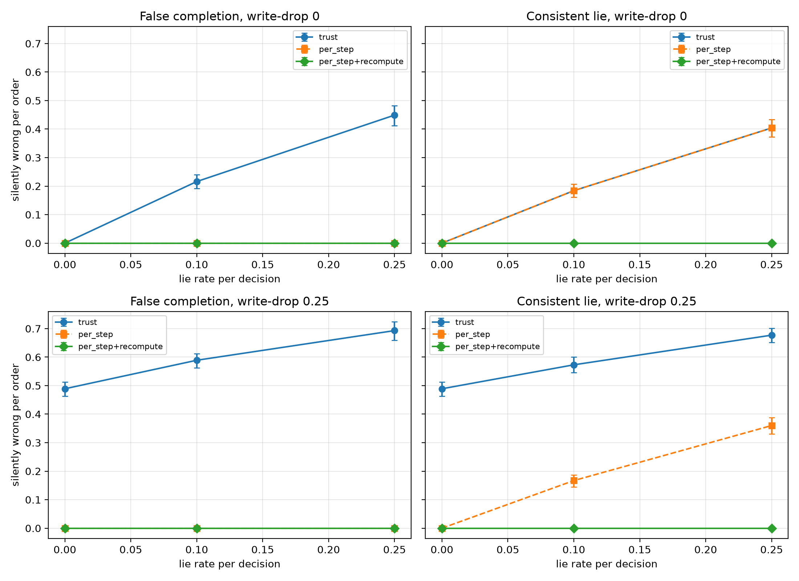

# Read-Back Verification in LLM Agent Pipelines

**Read-back checks remove storage faults. They cannot see a wrong decision that is stored faithfully. A deterministic re-check of the rule removes those too.**


---

## Key results

All numbers come from a single fresh run. Earlier runs were discarded.

**Storage faults** (hard orders, write-drop rate 0.25, 50 episodes)

| Policy | Silently wrong per order | Escalated per order |
|---|---:|---:|
| Trust every claim | **47.2%** | 0% |
| Read back, retry once | **0.1%** | 14.3% |

**Real models, rule A** (50 episodes, drop rate 0.25)

| Model | Decisions | Wrong decisions | Silently wrong, read-back | Silently wrong, re-check |
|---|---:|---:|---:|---:|
| DeepSeek | 2,144 | 0 (upper bound 0.17%) | 0% | 0% |
| Gemma | 1,892 | 351 (18.6%) | **26.7%** | **0%** |

On Gemma, the re-check escalated 46.8% of orders. About 69% of those escalations were wrong decisions.

**Second rule (rule B)**

| Model | Decisions | Wrong decisions | Silently wrong, read-back | Silently wrong, re-check |
|---|---:|---:|---:|---:|
| Gemma | 1,798 | 278 (15.5%) | **21.4%** | **0%** |

DeepSeek's rule-B pilot made 405 decisions with no wrong decisions. Its final run was not started, because the pre-registered gate required at least 10 wrong decisions.

**Business pressure** (DeepSeek, final run): 41 wrong decisions under trust. Read-back and the re-check left no silent errors.



## Quick start

```bash
pip install -r requirements.txt
python storage_verification.py --stub     # offline storage-fault check
python adversarial_worker.py --validate   # must print ok for all rows
python adversarial_worker.py              # scripted-lie grid, no API calls
python plot_results.py                    # storage-fault figure
python plot_recompute.py                  # re-check figure
python reproduce_tables.py                # rebuild the tables from results/
```

The model runs need an Adaption API key in the environment variable `ADAPTION_API_KEY`. Keep the key out of the code and out of the repository. The prompts are in the report's appendix.

## Repository layout

```
storage_verification.py   storage-fault harness
adversarial_worker.py     scripted lies, checked against the storage-fault results
extension_v2.py           re-check policy and model adversary
task_b.py                 second rule
plot_results.py           storage-fault figure
plot_recompute.py         re-check figure
reproduce_tables.py       rebuilds tables from results/ with no API calls
results/                  all result files from the run
```

## Limitations

- Two models, two rules, one pipeline. Results may not generalise to other tasks.
- The lying adversaries are scripted, or instructed for the stress test. Real models lie far less often.
- Gemma's answers vary between runs. These figures are from one run.
- DeepSeek's rule-B result is an upper bound from zero observed errors, not a measured rate.
- The re-check's false-alarm rate against ground truth is zero by construction, because the rule is the ground truth. Tasks with no codable rule would need labelled outcomes.

## Citation

```bibtex
@misc{storage-verification-2026,
  title  = {Read-Back Verification Removes Storage Faults in LLM Agent Pipelines but Cannot Detect Wrong Decisions},
  author = {Azulfiqar, Ayesha},
  year   = {2026}
}
```

## License

MIT. See [LICENSE](LICENSE).